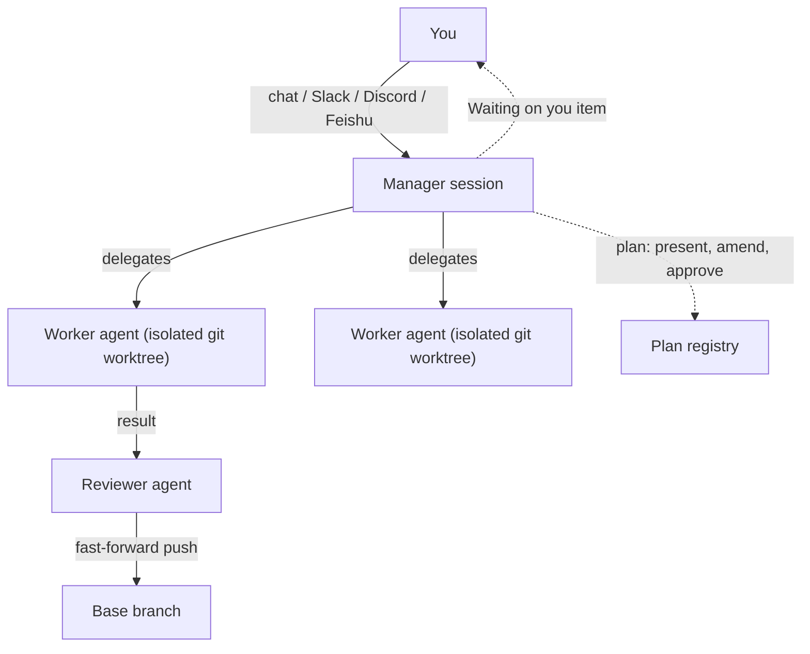
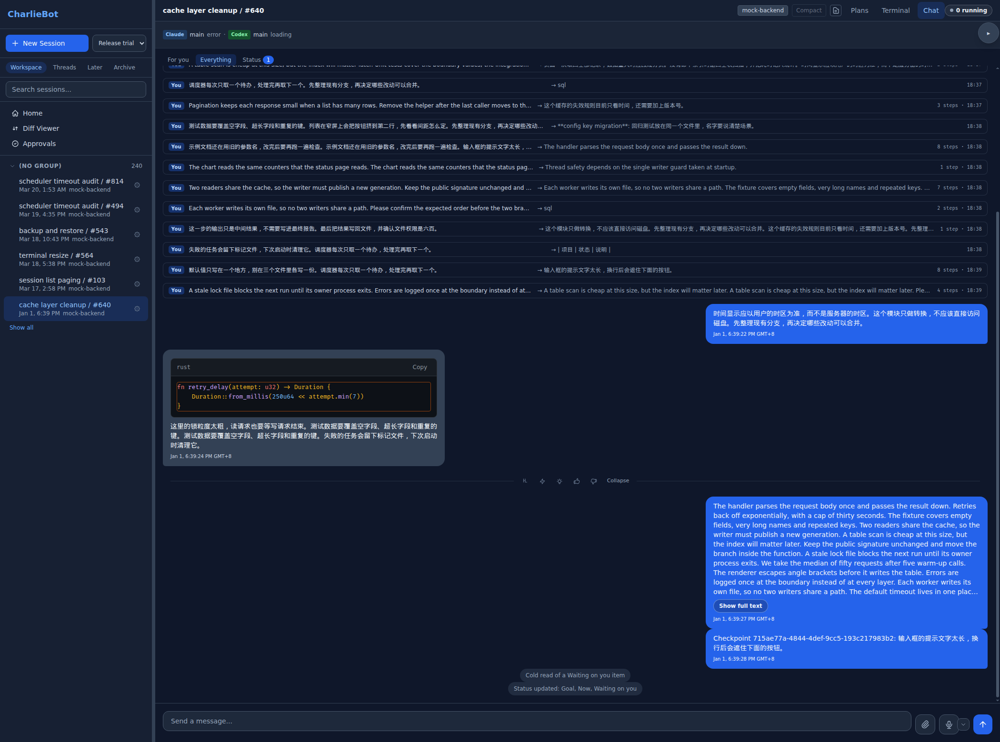
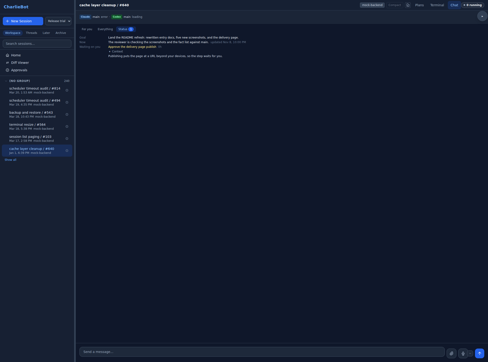
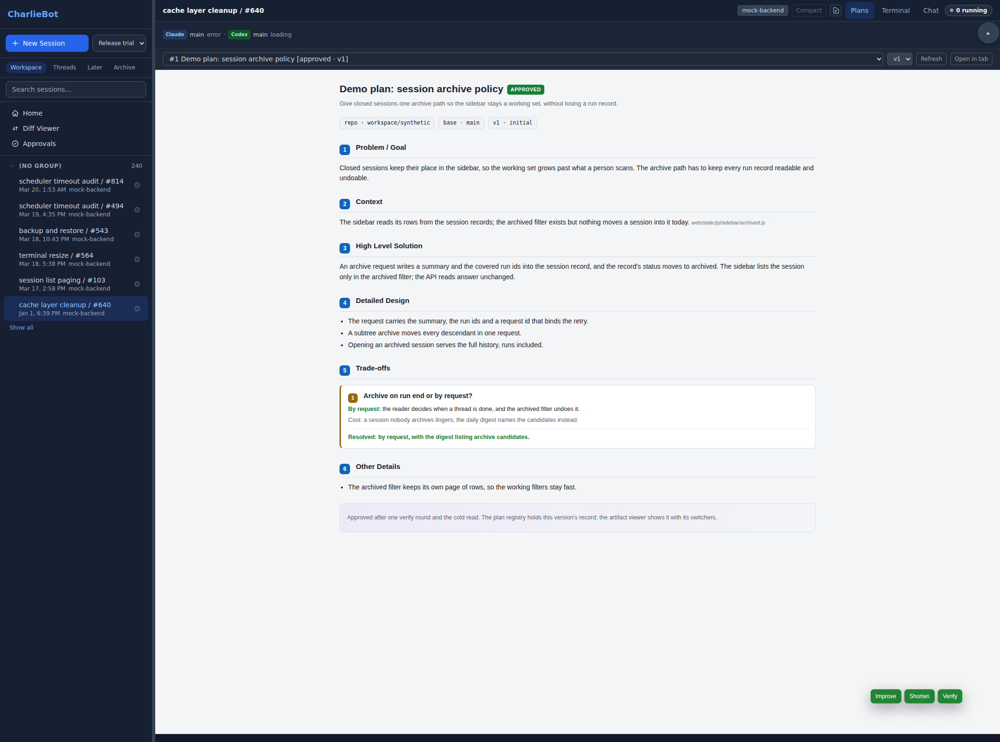
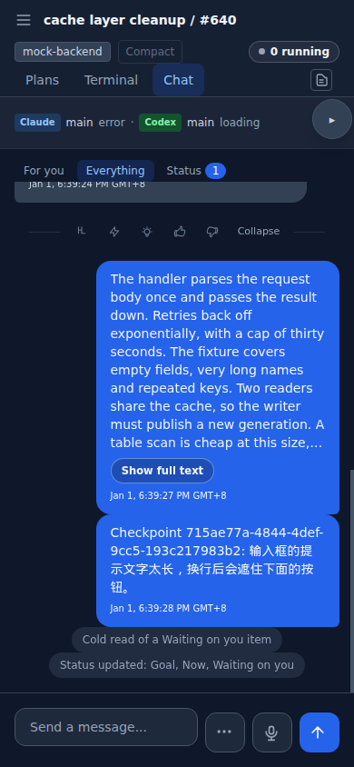

# CharlieBot

CharlieBot is a self-hosted agent system for real work: you chat with a master agent, it plans the
job, delegates it to worker agents that each work in an isolated git worktree, and a reviewer agent
checks the result before it lands on the base branch. The whole tree runs on your own machine,
across pluggable LLM CLI backends, and is operated through a web UI.
Steps that should not happen silently — publishing, sending in your name, spending money — pass an
approval, and the steps the agent proceeds with on its own are reported with how to undo them.

## How it works

Every conversation is a session, and sessions form a tree: the session you talk to is a manager,
and the work it does not do itself it delegates to child sessions — worker agents that run in
isolated git worktrees, and the reviewer that checks their result and pushes it to the base branch
with a fast-forward-only push. A manager presents its approach as a plan in the plan registry
before large work starts; plans carry versions and an approval record. What an agent may do on its
own is bounded by two rules: a high-consequence step becomes a Waiting on you item that waits for your take off,
and a reversible step proceeds with its undo stated in the reply.



## Features

### Orchestration

- Master/worker/reviewer delegation in isolated git worktrees, integrated by fast-forward-only pushes to the base branch
- Pluggable backends: Claude Code, Anthropic-compatible, OpenAI-compatible, Codex, Gemini CLI, OpenCode, Charlie Code, Antigravity CLI, and Devin
- Backend router: a routing config maps classes of work to backends, and the pool rotates among the healthy ones
- `charliebot improve start` runs an autonomous change-run-verify iteration loop on a task
- Plan registry (`charliebot plan`): HTML plan artifacts with versions, anchored comments, and the present-amend-approve lifecycle
- Cron scheduled tasks — a prompt (inline or from a file), a handler, or a task chain (`steps`); `POST /api/cron/tasks/{name}/run` fires one now
- Delayed triggers (`charliebot session trigger`) watch local and remote PIDs and SLURM jobs — one trigger can watch many targets — and `--cmd` starts a detached command whose wake carries the exit code and log path

### Approvals and oversight

- Action boundaries: a high-consequence step becomes a Waiting on you item that holds the work until you take it off; a reversible step proceeds and its reply states how to undo it
- Draft cards: a message or publication in your name waits on an approval card only you can send
- Failure triage: `charliebot triage scan` groups a time window of failed runs and error logs by signature and prints one verdict per signature

### Knowledge

- Memory store: labeled entries with topic/audience scoping, queried mid-session via `charliebot memory`
- Taste index: your choice precedents, recorded through `charliebot taste` and placed before every manager and worker run
- Skills system: repo-shared (`skills/`) plus host-specific skills

### Web UI

- Streaming chat over WebSockets, with a sessions sidebar that has groups, filters, and search; star / archive / fork sessions
- Per-session reading views: For you shows the replies addressed to you, and Status shows the session's Goal, Now and Waiting on you items
- Worker (thread) and plan panels; HTML artifact viewer with line-anchored comments; GitHub-style diff viewer
- Perfetto trace viewer, built-in web terminal (tmux), and the explain panel
- Voice input with online speech transcription (Gemini and Muse backends)
- Usage panels: external provider quotas and per-session context usage
- File browser (`/absolute_filepath/`) and file uploads
- Host login panel (`/host-auth`): a standing poller probes every ssh alias in the config, with a browser-login page for the hosts that need one
- Access-key auth

### Chat platforms

- Slack, Discord, and Feishu summon entrypoints on a shared thread core — see [docs/discord.md](docs/discord.md) and [docs/chat-platforms.md](docs/chat-platforms.md)

### Integrations

- Web search for agents: `POST /api/web-search/mcp`, an MCP endpoint that grounds searches and resolves redirects to their real URLs
- `charliebot github` opens draft pull requests and posts comments with your own token, behind a draft-target validation
- `charliebot google` mints an account's access token in-process and sends authenticated Google requests; the token never reaches a command line or a run record
- `charliebot linear` sends GraphQL requests to Linear with the stored credential
- code-server proxying (browser VS Code)
- Anthropic Messages-compatible proxy endpoint (`POST /api/anthropic-proxy/openai-compatible/{backend_id}/v1/messages`) fronting OpenAI-compatible backends

### Operations

- Scheduled home backup to the configured restic repository, with tiered retention
- Disk sweep: finished task worktrees and scratch directories are archived and removed
- Run-log compaction: run logs past an age are stored compressed in place

## Screenshots

<p align="center">
  
</p>
<p align="center"><i>Desktop: a session's Everything view — user messages, tool calls with their results, and the sessions sidebar. All content is fabricated demo data.</i></p>
<p align="center">
  
</p>
<p align="center"><i>Desktop: the same session's Status view — the Goal, Now and Waiting on you items that hold work until you act.</i></p>
<p align="center">
  
</p>
<p align="center"><i>Desktop: the plans panel — an approved plan's HTML artifact with its version switcher and resolved trade-offs.</i></p>
<p align="center">
  
</p>
<p align="center"><i>Mobile: the same chat in a phone-width layout.</i></p>

The screenshots are generated from fabricated demo data by [`dev/readme-screenshots/capture.sh`](dev/readme-screenshots/capture.sh).

## Quick start

You need git to clone this repository, and Node.js to run the frontend JavaScript tests. Build the
server and CLI from `rust/` with the Rust toolchain (1.99), or install the release that CI built for
a `main` commit:

```bash
scripts/release.sh <full main commit>   # download, trial and install the release CI built; prints the switch command
./scripts/setup.sh                      # provision $CHARLIEBOT_HOME (default ~/.charliebot), sync skills, seed repo-default cron tasks
# fill in the access key in $CHARLIEBOT_HOME/credentials.yaml: charliebot.access_key
./scripts/start-server.sh               # start the release that $CHARLIEBOT_RELEASES_DIR/current names
```

A later update installs the next release and switches the live server onto it —
`scripts/release.sh <commit>` then `scripts/switch-server.sh rust <commit>`. Each script's header
comment is the one home of its stages, checks and exit codes; these scripts take no other
documentation.

The README you are reading is on `main`; a release serves the checkout of its own commit, so the
[documentation](docs/project.md) and the prompts and skills it carries move with the release.

## CLI

The Rust `charliebot` binary is the only CLI, and it ships beside `charliebot-server` in the same
release. By workflow:

**Delegation and planning**

- `charliebot delegate` — delegate a task to a worker agent
- `charliebot improve start` / `improve stop` — start, or stop after the current iteration, an autonomous improvement loop on this session
- `charliebot plan` — present, amend, approve, close, diff, and list a session's plans
- `charliebot session` — create sessions, page the task tree, relay a message to another session (`send`), archive, retry, and set a task's approver; `session trigger` schedules a delayed trigger

**Pages and replies**

- `charliebot artifact` — check a page's genre assertions and cold read, or wrap a content fragment into a genre page
- `charliebot files` — probe a file link before you rely on it
- `charliebot publish` — publish an artifact to the URL readers beyond your devices open
- `charliebot web` — record a web reply, print a session's For-you layer, or set, confirm and show its status

**Approvals and knowledge**

- `charliebot memory` — query, lint and propose from the memory store; `add` stages a capture
- `charliebot taste` — add, query, mark and index the user's choice precedents

**Chat platforms**

- `charliebot slack` — reply to or ack the Slack thread a session was summoned from
- `charliebot discord` — reply to or read the Discord thread a session was summoned from, and check the bot setup
- `charliebot feishu` — reply to, read, or download from the Feishu thread a session was summoned from, check the app setup, and run the user-token verbs

**Other integrations**

- `charliebot github` — open a draft pull request or post a comment as the operator
- `charliebot google` — send one authenticated Google request, list the account table, and run the consent verbs
- `charliebot linear` — send one GraphQL request to Linear
- `charliebot voice` — transcribe an audio clip through the online transcription backend

**Operations**

- `charliebot triage` — scan a window of failed runs and error logs for grouped failure signatures
- `charliebot gc-trash` — inspect and purge quarantined worktree trash
- `charliebot backup restore` — restore one snapshot of the profile home into an empty directory

`charliebot --help` lists every subcommand the binary carries, including the internal hooks and
script helpers this page leaves out.

## Repository layout

Every root entry, one line each:

- `.github/` — the CI workflows: the Rust jobs, the frontend suite, the release build and the PR-contract check
- `.gitignore` — the build outputs, dependencies and local environments git ignores
- `AGENTS.md` — the repository guide for agents working in this checkout
- `LICENSE` — the MIT license
- `README.md` — this file
- `configs/` — example configuration and the repository's default cron tasks
- `dev/` — repository maintenance: git hooks, leak and style checks, the remote build runner, the browser and live harnesses, the eval runners, and the improve cron prompts
- `docs/` — the design documents, the project specification and supplementary assets
- `prompts/` — the agent prompt definitions and page templates
- `rust/` — the server and CLI workspace; `cargo` builds and tests here — see [rust/README.md](rust/README.md)
- `scripts/` — operator scripts: release install and switch, server launcher, setup, skill sync, charlie-code preflight
- `skills/` — repo-shared agent skills
- `web/` — the frontend: Jinja2 templates and static assets, the page packages under `web/features` and `web/backends`, and the `node --test` suites under `web/tests`

## Documentation

- [docs/project.md](docs/project.md) — the project specification
- [docs/registry.md](docs/registry.md) — how packages register routes, pages and services
- [docs/store-api.md](docs/store-api.md) — the session store's API
- [docs/chat-platforms.md](docs/chat-platforms.md) and [docs/discord.md](docs/discord.md) — the chat platform integrations
- [docs/networking.md](docs/networking.md) — the proxy and TLS setup around the server
- [rust/README.md](rust/README.md) — the developer guide for the Rust workspace

## License

MIT — see [LICENSE](LICENSE).
