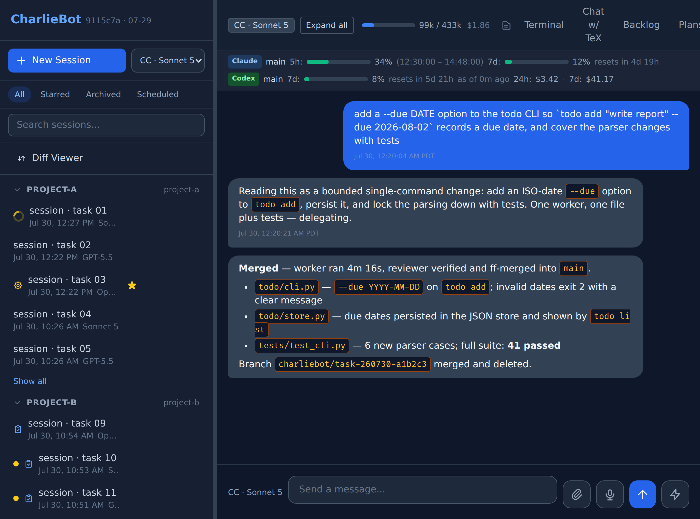
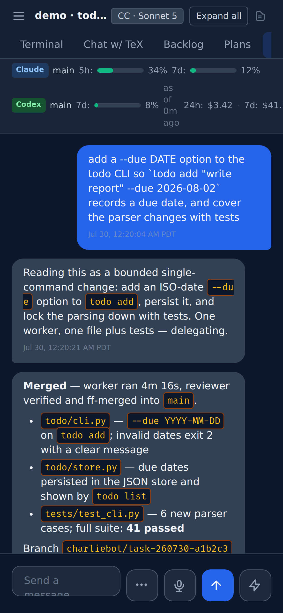
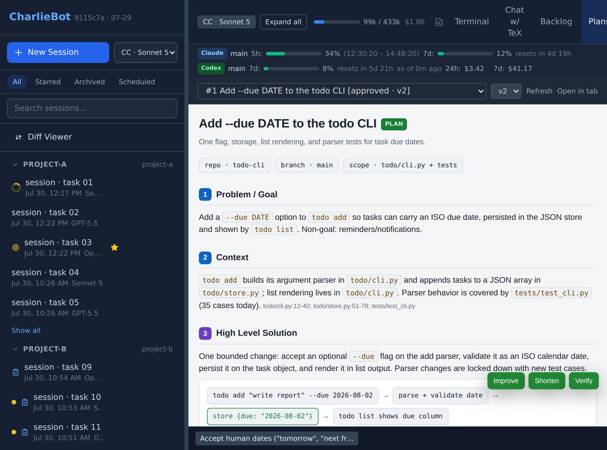

# CharlieBot

CharlieBot is a self-hosted multi-agent orchestration system: a master agent drives worker and reviewer agents across pluggable LLM CLI backends, operated through a web UI.

## Features

### Orchestration

- Master/worker/reviewer delegation in isolated git worktrees, integrated by fast-forward-only pushes to the base branch
- Pluggable backends: Claude Code, Anthropic-compatible, OpenAI-compatible, Codex, Gemini CLI, OpenCode, Charlie Code, Antigravity CLI
- Chat file uploads: text attachments ride the message's path text; image attachments reach the Charlie Code CLI as repeated `--image` flags by default, and are refused with one error event (nothing sent) when the backend entry sets `image_input: false`
- `charliebot improve` autonomous change-run-verify iteration loops
- Plan registry (`charliebot plan`) with HTML plan artifacts and anchored comments

### Automation

- Cron scheduled tasks in prompt, handler, loop, and task-chain (`steps`) modes
- Manual run of a scheduled task: `POST /api/cron/tasks/{name}/run` fires it once through the scheduled path
- Delayed triggers (`charliebot schedule-trigger`) watching local/remote PIDs and SLURM jobs; one trigger can watch many targets
- `charliebot schedule-trigger --cmd` starts a long-running command detached (locally or over ssh) and registers its wake; the wake carries the exit code and log path

### Knowledge

- Memory store: labeled entries with topic/audience scoping, queried mid-session via `charliebot memory`
- Skills system: repo-shared (`skills/`) plus host-specific skills

### Web UI

- Streaming chat over WebSockets
- Sessions sidebar with groups, filters, and search; star / archive / fork sessions
- Worker (thread) and plan panels
- HTML artifact viewer with line-anchored comments
- GitHub-style diff viewer with diff comments
- Perfetto trace viewer
- Built-in web terminal (tmux)
- Voice input with online speech transcription (Gemini and Muse backends)
- Usage panels: external provider quotas and per-session context usage
- File browser (`/absolute_filepath/`) and file uploads
- Access-key auth

### Integrations

- code-server proxying (browser VS Code)
- Anthropic Messages-compatible proxy endpoint (`POST /api/anthropic-proxy/openai-compatible/{backend_id}/v1/messages`) fronting OpenAI-compatible backends
- Slack and Discord summon entrypoints on a shared thread core — see [docs/discord.md](docs/discord.md) and [docs/chat-platforms.md](docs/chat-platforms.md)

## Screenshots

<p align="center">
  
</p>
<p align="center"><i>Desktop: chat view with the external-provider quota strip (Claude/Codex) and the per-session context usage indicator. Dollar values shown are fabricated demo data.</i></p>
<p align="center">
  
</p>
<p align="center"><i>Mobile: the same chat and session list in a phone-width layout.</i></p>
<p align="center">
  
</p>
<p align="center"><i>Plans: an approved plan's HTML artifact in the viewer — plan/version switchers, revision badges, and resolved trade-offs from the approval lifecycle.</i></p>

## Prerequisites

- Python 3.14 (uv installs it; the setup steps, the Python helper scripts and the pytest suite run on it) and git (worker tasks run in git worktrees)
- Node.js is only needed for frontend development

## Quick start

```bash
./scripts/setup.sh   # sync skills, provision $CHARLIEBOT_HOME (default ~/.charliebot), seed repo-default cron tasks
# fill in the secret in $CHARLIEBOT_HOME/credentials.yaml: charliebot.access_key
./scripts/start-server.sh
```

`start-server.sh` runs the release that `$RELEASES_DIR/current` names and refuses to start when there is none.

`scripts/release.sh <full main commit>` installs the server and Rust CLI that CI built for the same `main` commit. It downloads the `charliebot-server-<commit>` artifact, verifies `sha256sums.txt` for both binaries, runs the trial and switch rehearsal, then writes `$RELEASES_DIR/<commit>/` with both binaries, `release.log` holding each stage's verdict, and `sha256sums.txt`. It prints the switch command. `scripts/switch-server.sh rust <commit>` moves the live server onto that release and moves the runtime clone to its commit, forward or back; rolling back is the same command with an earlier release commit. The emergency return to the Python server is a checkout, not a switch: reset the runtime clone to `8fe3e5bee`, the last commit that carries the Python server, and run that commit's `scripts/switch-server.sh python`. The switch ends with a probe turn in a session of its own: it passes once the new server records the run's first assistant output (or the run ends success), then archives the session after stopping every run the session still has open, including a follow-up run the server starts in it. After the probe turn, the switch runs a delegation check: it delegates one `script-run` task on the runtime clone with base branch `main`, and passes only when the run ends `success` and its worktree exists. A failed check restores the previous release and exits 2; `CHARLIEBOT_SWITCH_DELEGATION_WAIT_S` bounds the wait (default 300 s). The script header lists the preflight and the exit codes.

`setup.sh` provisions `$CHARLIEBOT_HOME/` (home layout, `config.yaml` from `configs/config.example.yaml`, `credentials.yaml` from `configs/credentials.example.yaml`) and seeds repo-default cron tasks into `$CHARLIEBOT_HOME/config.d/cron.d/<name>.yaml` (one file per job). Server startup never writes cron config — only `setup.sh` does — so re-run `setup.sh` after pulling to pick up new repo-default cron tasks and skills.

## CLI at a glance

The Rust `charliebot` binary is the only CLI. It ships beside `charliebot-server` in the same
release, and each subcommand keeps the argv, stdout and exit codes of the Python CLI it replaced.

- `charliebot artifact` — check a page's genre DOM assertions and cold-read probe, or wrap a content fragment into a genre page
- `charliebot compaction-context` — restore the skills a manager session read before Claude compacted its context
- `charliebot delegate` — delegate a task to a worker agent
- `charliebot discord` — reply to or read the Discord thread a session was summoned from, and check the bot setup
- `charliebot gc-trash` — inspect and purge quarantined worktree trash
- `charliebot improve` — start an iterative improvement loop
- `charliebot improve-stop` — stop this session's running improvement loop after the current iteration
- `charliebot memory` — query, lint and propose from the store; `add` stages a capture
- `charliebot plan` — present (register), amend, approve, close, diff, and list a session's plans
- `charliebot publish` — publish an artifact to the URL readers beyond the operator's devices open
- `charliebot schedule-trigger` — schedule a delayed trigger (timed, watching PIDs/SLURM jobs, or starting a command with `--cmd`)
- `charliebot session` — create a session; `send` relays a message to another session as an agent_message
- `charliebot slack` — reply to or ack the Slack thread a session was summoned from
- `charliebot web` — reply to a web session, print its For-you layer as plain text, or set and show its status

The Python-only `config`, `disk-sweep`, `router`, `storage`, `usage-ledger` and `voice-replay-eval`
subcommands have no Rust port and no caller; the binary answers them with the unknown-subcommand
error.

## Repository layout

- `rust/crates/` — the server that runs: `app/server` is the `charliebot-server` entry point, `app/cli` holds the Rust CLI commands, `runtime/` carries the task tree, agent processes and the session store, `features/` one crate per feature, `infra/` the shared foundations
- `src/` — the Python modules the remaining Python programs load (setup, config, session conversion, voice transcription, the opencode bench) and the Rust server's static assets and templates
- `web/` — Jinja2 templates + vanilla JS static assets, served by the Rust server
- `skills/` — repo-shared agent skills
- `prompts/` — agent prompt definitions
- `scripts/` — operator scripts: setup, server launcher, release install and switch, skill sync, charlie-code preflight
- `tools/` — maintenance tools: style and leak checks, git hooks, browser and live harnesses, CSS build
- `tests/` — pytest suite; `tests/test_package_structure.py` fails on an import that crosses the `src` packages against their directions
- `configs/` — example config and repo-default cron tasks
- `docs/` — supplementary documentation and assets

## License

MIT — see [LICENSE](LICENSE).
